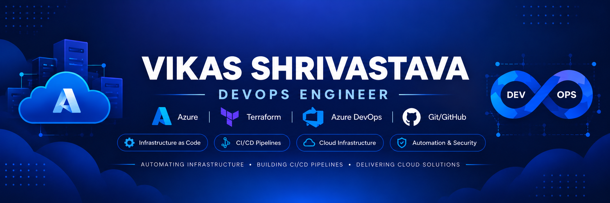

  

Building secure, scalable and automated cloud infrastructure on Microsoft Azure.

## 👨‍💻 About Me

- ☁️ Hands-on experience with **Microsoft Azure, Terraform and Azure DevOps**
- 🏗️ Building **reusable Infrastructure as Code** using Terraform modules
- 🚀 Implementing **CI/CD automation** using Azure DevOps YAML pipelines
- 🔐 Working with **Azure networking, security, Application Gateway, DevSecOps and Hub-Spoke architecture**
- 📚 Exploring **Azure Firewall, Landing Zones, Docker, Azure Kubernetes Service (AKS)**
- 🌐 Automating infrastructure provisioning and deployment for **three-tier applications on Azure**

  

## 🛠️ Tech Stack

### ☁️ Cloud & Infrastructure

  

### 🚀 CI/CD & DevOps

  
  

### 🔐 Code Quality & Security

### 💻 Operating System & Web

  

---

## 🚀 Featured Projects

### 🏗️ Azure Three-Tier Infrastructure Automation

Designed and automated a production-style three-tier infrastructure on Microsoft Azure using reusable Terraform modules and Azure DevOps CI/CD pipelines.

**Architecture & Implementation**
- Built reusable Terraform modules for **VNet, Subnets, NSG, NIC, VM, Load Balancer, Application Gateway, Bastion and Key Vault**
- Implemented **Application Gateway → Frontend VMs → Internal Load Balancer → Backend VMs** architecture
- Used **Azure Storage Account Remote Backend** with Terraform state locking
- Created separate **PR validation and deployment pipelines**
- Integrated **TFLint, tfsec and Infracost** into the Terraform pipeline
- Used **Pull Request workflow and branch protection** to control infrastructure changes

**Tech:** `Azure` `Terraform` `Azure DevOps` `GitHub` `Linux` `NGINX`

🔗 **Repository:** [azure-three-tier-infra](https://github.com/Vikas-Shrivastava-hub/azure-three-tier-infra)

### 🌐 Azure Hub-and-Spoke Network Architecture

Designed and deployed an Azure Hub-and-Spoke network architecture using reusable Terraform modules with centralized traffic control through Azure Firewall.

**Architecture & Implementation**
- Created separate Hub, Dev and Prod VNets using Terraform modules
- Configured VNet Peering for Hub-and-Spoke connectivity
- Deployed Azure Firewall with Firewall Policy and network rules
- Implemented User Defined Routes (UDRs) to route inter-spoke traffic through Azure Firewall
- Configured NSGs for subnet-level network security
- Validated private connectivity between Dev and Prod VMs through Azure Firewall

**Tech:** `Azure` `Terraform` `Azure Firewall` `VNet Peering` `UDR` `NSG`

🔗 **Repository:** [azure-hub-spoke-terraform](https://github.com/Vikas-Shrivastava-hub/azure-hub-spoke-terraform)

### ☸️ Axion AKS Infrastructure

Hands-on AKS project focused on deploying and exposing a multi-service application on **Azure Kubernetes Service**.

- Provisioned AKS infrastructure using Terraform
- Integrated Azure Container Registry (ACR) for container images
- Deployed application components using Kubernetes manifests
- Configured Kubernetes Services and NGINX Ingress for application traffic

**Tech:** `Azure` `AKS` `Terraform` `Kubernetes` `Docker` `ACR` `NGINX`

🔗 **Repository:** [axion-aks-infrastructure](https://github.com/Vikas-Shrivastava-hub/axion-aks-infrastructure)

---

## 🤝 Connect With Me

&nbsp;&nbsp;

